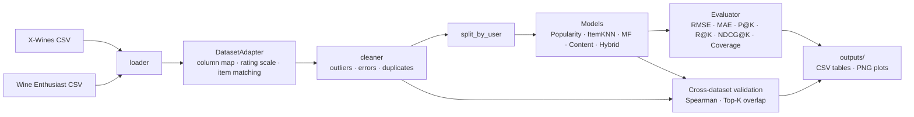

# Cross-Dataset Wine Recommendation System

Machine Learning Term Project (Fall 2026) · Team 8

A wine recommender trained on **general users' ratings (X-Wines)** and validated on
**expert reviews (Wine Enthusiast)**. A reusable `DatasetAdapter` aligns the two
datasets (rating scale, attribute names, item matching) and handles outliers and errors.

| Filtering method | Implementation |
|---|---|
| Model-based collaborative filtering | Matrix Factorization trained with SGD + L2 regularization (`recsys/models/mf.py`) |
| Content-based filtering | Wine attribute vectors + cosine similarity (`recsys/models/content.py`) |
| Hybrid filtering | Weighted CF + content score, content-heavier for cold-start users (`recsys/models/hybrid.py`) |
| Baselines | Popularity, item-based KNN (memory-based CF) (`recsys/models/baseline.py`) |

## Architecture



Every model implements the same interface (`recsys/models/base.py`):

```python
model = SomeModel(**params).fit(train, items)
model.score(user_id, item_ids)   # one score per item (higher = better)
model.recommend(user_id, k=10)   # top-k item_ids, unseen items only
model.predict(user_id, item_id)  # predicted rating (rating models only)
```

## Project structure

```
config.yaml                  all paths and hyper-parameters
run.py                       end-to-end pipeline
recsys/
  config.py                  config loader
  data/loader.py             read raw CSV files
  data/adapter.py            DatasetAdapter: common schema, rating scale, item matching
  data/cleaner.py            outlier / error handling, data quality report
  data/split.py              per-user train/test split
  models/base.py             common Recommender interface
  models/baseline.py         Popularity, ItemKNN
  models/mf.py               Matrix Factorization
  models/content.py          content-based filtering
  models/hybrid.py           hybrid filtering
  eval/metrics.py            RMSE, MAE, Precision@K, Recall@K, NDCG@K, coverage
  eval/evaluator.py          evaluates every model the same way
  eval/analysis.py           cold-start analysis, error analysis
  eval/cross_dataset.py      X-Wines vs Wine Enthusiast agreement
  utils/plots.py             figures for the report
data/sample/                 X-Wines Test version (100 wines, 1K ratings) for smoke tests
data/raw/                    put the real datasets here (not committed)
docs/                        library explanations, citations, team guide
outputs/                     results and plots (generated)
```

## Setup

```bash
pip install -r requirements.txt
python run.py --data sample        # quick check with the bundled sample
```

**Datasets** (put the files in `data/raw/`):

1. **X-Wines Slim** – download `XWines_Slim_1K_wines.csv` and
   `XWines_Slim_150K_ratings.csv` from the official Google Drive linked at
   <https://github.com/rogerioxavier/X-Wines>. If the file names differ, any CSV
   whose name contains `wines` / `ratings` is picked up automatically.
2. **Wine Enthusiast Reviews** – `winemag-data-130k-v2.csv` from
   <https://www.kaggle.com/datasets/zynicide/wine-reviews>.

```bash
python run.py                      # full experiment
python run.py --models mf hybrid   # only some models
```

**Google Colab**

```python
from google.colab import drive
drive.mount('/content/drive')
%cd /content/drive/MyDrive/wine-recsys
!pip install -q -r requirements.txt
!python run.py --data sample
```

## Outputs

| File | Content |
|---|---|
| `outputs/results.csv` | metrics of every model |
| `outputs/cold_start_analysis.csv` | metrics by number of training ratings per user |
| `outputs/cross_dataset.csv` | agreement with expert scores |
| `outputs/compare_*.png` | model comparison charts |
| `outputs/learning_curve_*.png` | training curves (models that log `history`) |
| `outputs/eda_rating_distribution.png` | rating distributions of both datasets |

## Team

| Member | Role | Files |
|---|---|---|
| 김도원 | Data exploration, DatasetAdapter, cleaning | `data/adapter.py`, `data/cleaner.py` |
| 김한결 | Collaborative filtering (MF) | `models/mf.py` |
| 최정원 | Content-based & hybrid filtering | `models/content.py`, `models/hybrid.py` |
| 신우엽 | Evaluation, baselines & analysis | `models/baseline.py`, `eval/*` |

## References

See [`docs/CITATIONS.md`](docs/CITATIONS.md). Libraries and functions not covered in
class are explained in [`docs/LIBRARIES.md`](docs/LIBRARIES.md).
