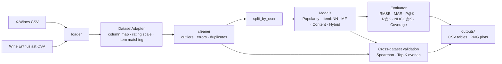

# Cross-Dataset Wine Recommendation System

Machine Learning Term Project (Fall 2026) · Team 8

A wine recommender trained on **general users' ratings (X-Wines)**. The main model
comparison uses **10-fold cross-validation** on X-Wines. A separate evaluation
compares wine rankings with **Wine Enthusiast expert reviews** after matching wines.

| Filtering method | Implementation |
|---|---|
| Model-based collaborative filtering | Matrix Factorization trained with SGD + L2 regularization (`recsys/models/mf.py`) |
| Content-based filtering | Wine attribute vectors + cosine similarity (`recsys/models/content.py`) |
| Hybrid filtering | Weighted CF + content score, content-heavier for cold-start users (`recsys/models/hybrid.py`) |
| Popularity + Hybrid (50:50) | Equal-weight blend of popularity and Hybrid scores after min-max scaling across each user's recommendation candidates (`experiments/compare_popularity_hybrid.py`) |
| Baselines | Popularity, item-based KNN (memory-based CF) (`recsys/models/baseline.py`) |

## Architecture

The diagram shows the default `run.py` pipeline. The 10-fold experiment uses
the same X-Wines preparation and model settings, then evaluates on folds
within the training portion of the split.



Every model implements the same interface (`recsys/models/base.py`):

```python
model = SomeModel(**params).fit(train, items)
model.score(user_id, item_ids)   # one score per item (higher = better)
model.recommend(user_id, k=10)   # top-k item_ids, unseen items only
model.predict(user_id, item_id)  # predicted rating (rating models only)
```

## Project structure

```
config.yaml                  all paths and hyper-parameters
run.py                       end-to-end pipeline
recsys/
  config.py                  config loader
  data/loader.py             read raw CSV files
  data/adapter.py            DatasetAdapter: common schema, rating scale, item matching
  data/cleaner.py            outlier / error handling, data quality report
  data/split.py              per-user train/test split
  models/base.py             common Recommender interface
  models/baseline.py         Popularity, ItemKNN
  models/mf.py               Matrix Factorization
  models/content.py          content-based filtering
  models/hybrid.py           hybrid filtering
  eval/metrics.py            RMSE, MAE, Precision@K, Recall@K, NDCG@K, coverage
  eval/evaluator.py          evaluates every model the same way
  eval/analysis.py           cold-start analysis, error analysis
  eval/cross_dataset.py      X-Wines vs Wine Enthusiast agreement
  utils/plots.py             figures for the report
experiments/
  cross_validate.py          10-fold comparison of the five base models and the 50:50 blend
  compare_popularity_hybrid.py  popularity and Hybrid score blending
data/sample/                 X-Wines Test version (100 wines, 1K ratings) for smoke tests
data/raw/                    put the real datasets here (not committed)
docs/                        library explanations, citations, team guide
outputs/                     results and plots (generated)
```

## Setup

```bash
pip install -r requirements.txt
python run.py --data sample        # quick check with the bundled sample
```

**Datasets** (put the files in `data/raw/`):

1. **X-Wines Slim** – download `XWines_Slim_1K_wines.csv` and
   `XWines_Slim_150K_ratings.csv` from the official Google Drive linked at
   <https://github.com/rogerioxavier/X-Wines>. If the file names differ, any CSV
   whose name contains `wines` / `ratings` is picked up automatically.
2. **Wine Enthusiast Reviews** – `winemag-data-130k-v2.csv` from
   <https://www.kaggle.com/datasets/zynicide/wine-reviews>.

```bash
python run.py                      # single train/test split and expert comparison
python run.py --models mf hybrid   # only some models
python experiments/cross_validate.py --data sample  # quick 10-fold check
python experiments/cross_validate.py --data slim    # main 10-fold model comparison
```

Run every command from the repository root (the folder that contains `run.py`).

## 10-fold evaluation

The experiment reserves the original test split and creates ten validation folds
from the training portion. Eligible users keep some ratings in training in
every fold. Users below the profile's minimum rating count stay in training.
The same folds and seeded ranking sample are used for every model. On Slim, each
fold evaluates Top-10 recommendations for 2,000 users with at least one held-out
rating of 4 or higher.

The 50:50 blend holds the ratio fixed across folds. The earlier experiment
selected that ratio using part of the same training pool. Evaluating the
ratio-selection procedure itself would require an inner validation split
within each fold.

| Model | NDCG@10 (mean ± SD) | P@10 | Recall@10 | Coverage |
|---|---:|---:|---:|---:|
| Popularity | 0.0553 ± 0.0053 | 1.29% | 11.63% | 1.64% |
| ItemKNN | 0.0040 ± 0.0011 | 0.09% | 0.83% | 96.48% |
| MF | 0.0354 ± 0.0028 | 0.84% | 7.29% | 2.31% |
| Content | 0.0275 ± 0.0023 | 0.64% | 5.52% | 93.81% |
| Hybrid | 0.0440 ± 0.0036 | 1.00% | 8.63% | 35.66% |
| **Popularity + Hybrid (50:50)** | **0.0716 ± 0.0056** | **1.58%** | **14.03%** | 6.79% |

The blend ranked held-out favorites higher and found more of them than either
component alone. Its recommendation coverage was wider than Popularity's and
narrower than Hybrid's. The external expert comparison uses matched wines and
Spearman rank correlation. See [the matching analysis](docs/CLEAN_MATCH_COMPARISON.md).

## Outputs

| File | Content |
|---|---|
| `outputs/results.csv` | model metrics from the default single train/test split |
| `outputs/cross_validation/<profile>/folds.csv` | metrics for each model and validation fold |
| `outputs/cross_validation/<profile>/summary.csv` | mean, sample standard deviation, and count of available fold scores per model and metric |
| `outputs/cold_start_analysis.csv` | metrics by number of training ratings per user |
| `outputs/cross_dataset.csv` | agreement with expert scores |
| `outputs/compare_*.png` | model comparison charts |
| `outputs/learning_curve_*.png` | training curves (models that log `history`) |
| `outputs/eda_rating_distribution.png` | rating distributions of both datasets |

## Team

| Member | Role | Files |
|---|---|---|
| 김도원 | Data exploration, DatasetAdapter, cleaning | `data/adapter.py`, `data/cleaner.py` |
| 김한결 | Collaborative filtering (MF) | `models/mf.py` |
| 최정원 | Content-based & hybrid filtering, popularity blend | `recsys/models/content.py`, `recsys/models/hybrid.py`, `experiments/compare_popularity_hybrid.py` |
| 신우엽 | Evaluation, baselines & analysis | `recsys/models/baseline.py`, `recsys/eval/*`, `experiments/cross_validate.py` |

## References

See [`docs/CITATIONS.md`](docs/CITATIONS.md). Libraries and functions not covered in
class are explained in [`docs/LIBRARIES.md`](docs/LIBRARIES.md).
